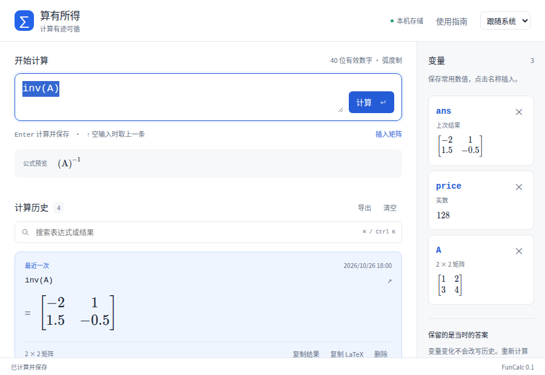
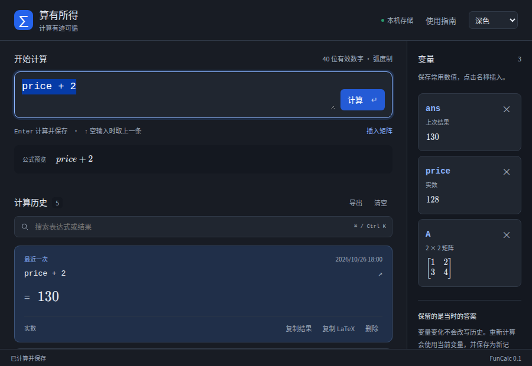

<p align="center"></p>

# 算有所得 · FunCalc

[产品主页](https://farfarfun.github.io/packages/utools-funcalc/)

计算有迹可循。一个支持**变量、矩阵、LaTeX 排版与持久化历史**的 uTools 计算笔记本。

[](https://github.com/farfarfun-utools/utools-funcalc/actions/workflows/ci.yml)

## 界面预览

以下截图来自采用统一品牌图标后通过的 [GitHub Actions 真实浏览器测试](https://github.com/farfarfun-utools/utools-funcalc/actions/runs/40375650527)。



<details>
<summary>查看深色模式</summary>



</details>

## 安装状态与开发者目录

**当前没有已验证可安装的 `.upxs`。** 用户客户端不识别此前提供的 `.upx`，相关 Release 附件已撤回。请勿继续使用，也不要通过修改后缀尝试安装。

[Release 页面](https://github.com/farfarfun-utools/utools-funcalc/releases/tag/v0.1.1)提供明确标注的开发者构建目录；也可从 [Actions](https://github.com/farfarfun-utools/utools-funcalc/actions/workflows/ci.yml) 下载 `utools-funcalc-developer-files`。解压后包含 `plugin.json`、preload、图标和已编译的 `dist/`，本机无需编译。

请按[开发者加载说明](docs/developer-install.md)在官方 uTools 开发者工具中配置工程，使用「安装（开发模式）」测试。正式 `.upxs` 仍需通过官方工具导出并在目标客户端验收，仓库当前未实现这一环节。

开发模式中可使用 `算有所得`、`FunCalc`、`计算笔记`、`历史计算器` 或 `矩阵计算` 入口；选中文字后也可选择「计算表达式」。

## 怎么用

| 输入 | 用途 |
| --- | --- |
| `0.1 + 0.2` | 得到 `0.3`；使用 40 位有效数字的十进制运算 |
| `(128 + 64) * 0.85` | 四则运算、括号；也支持 `×`、`÷` |
| `200 * 10%` | 百分比运算 |
| `price = 128`，然后 `price * 3` | 定义并复用变量 |
| `ans / 2` | 使用上次计算结果 |
| `A = [1, 2; 3, 4]` | 矩阵：逗号分列、分号换行 |
| `A * A` / `A .* A` | 矩阵乘法 / 逐元素相乘 |
| `transpose(A)` / `det(A)` / `inv(A)` | 转置 / 行列式 / 逆矩阵 |
| `sqrt(2)` / `sin(pi / 6)` | 常用数学函数；三角函数采用弧度制 |

输入时显示公式预览，按 **Enter** 计算并保存。点击历史表达式重新编辑，按 Enter 使用**当前变量**重新计算。修改变量不会改写历史的旧答案。

- 变量和结果在侧栏显示；点击变量名插入输入框。关闭插件后重新打开仍会保留。
- 结果与矩阵通过 KaTeX 排版；支持复制纯文本结果或 LaTeX。输入语言是数学表达式，**不是 LaTeX 源码**。
- **Ctrl/Cmd + K** 搜索历史；空输入框按 **↑** 取上一条表达式。
- 删除单条后可撤销；清空全部历史须确认，变量会保留。
- 可导出历史与变量为 JSON 存档。当前版本暂不提供 JSON 导入。
- 浅色、深色、跟随系统三种外观，公式字体随插件一起打包，运行时无需联网。

## 数据与边界

历史和变量保存在插件页面的 **IndexedDB**，一次计算通过同一事务提交两者。写入失败会明确报错，原记录保留；不自动截断或删除历史。多个窗口同时修改时拒绝覆盖过期状态，提示重新载入。

插件本身没有服务器、遥测、模型调用或云同步。清除插件数据、卸载插件或更换运行环境可能清除本机数据库，请按需导出存档。

第一版支持实数、向量与二维矩阵；最多 64 个命名变量，向量最多 16 项、矩阵最大 16 × 16，单条表达式最多 500 字符，幂指数绝对值不超过 1000。循环小数和超出 40 位有效数字的结果会舍入，不是符号代数系统。

只开放计算所需的运算符和函数，不执行 JavaScript、不开放动态导入、属性访问或自定义函数。目前没有绘图、单位换算、符号求导、复数和方程求解。

## 开发与验证

Vue 3 + TypeScript + mathjs + KaTeX。Node.js ≥ 22.22.2，pnpm 12。

```sh
pnpm install --frozen-lockfile
pnpm dev
```

发布构建统一由 GitHub Actions 执行：三平台代码检查、类型检查、单元测试和 Vite 构建；Linux 使用 runner 预装的 Chrome 运行浏览器回归测试，覆盖历史恢复、矩阵排版、主题、输入法、搜索、删除与窄屏布局，并上传截图和开发者构建目录。仓库中 `sh build.sh` 为统一构建入口。

推送与 `package.json` / `plugin.json` 一致的 `v*` 标签可触发开发者预览 Release，生成明确命名的 `-developer.zip` 和 `SHA256SUMS`，不会生成或发布 `.upx` / `.upxs` 安装包。

详见 [交互设计](docs/design.md)。[MIT](LICENSE) · [farfarfun-utools](https://github.com/farfarfun-utools)

## 发布验证范围

此前验证过 ZIP 或 gzip/ASAR 结构，但这不能证明当前 uTools 客户端接受文件。用户已确认需要 `.upxs`，旧 `.upx` 发布路径已停止，相关打包器已移除。

目前验证范围为源码检查、Web 构建、单元测试与浏览器交互测试。官方 `.upxs` 导出、签名及真实客户端安装验收尚未完成。
